# a4ai Voice Agent — plan (Phase 0 recon, 10 Nov 2026)

Voice is an input/output layer over the existing a4ai Agent. Nothing in the agent loop, tools, verification gate,
approval gate or store is rewritten. Speech → transcript → the same `POST /agent/chat` turn → the same events on
screen → one short spoken sentence. Hindi, English and Roman Hinglish only.

## 0. Phase 0 result: a working agent exists

Branch `claude/youthful-archimedes-tw0p0s` in both repos (backend PR #6, frontend PR #21), HEAD `31a87ba` /
`976d6dc`. Baseline before any voice code:

| suite | command | result |
|---|---|---|
| backend | `AGENT_DB=embedded AGENT_STORE=memory python -m pytest tests/agent -q` | **254 passed, 13 skipped, 1 failed** |
| frontend | `npx vitest run` | **374 passed** |

The one backend failure is pre-existing: `tests/agent/test_contract.py::test_committed_openapi_matches_generated`.
The committed `docs/agent_openapi_v2.json` was exported with an older pydantic; the installed pydantic 2.14.3 adds
`input` / `ctx` to FastAPI's `ValidationError` component (a 12-line cosmetic diff, no agent schema changed). Phase 1
adds routes, so the file is regenerated then (`python scripts/export_openapi.py`) and the test goes green.

## 1. What exists (file:line)

### Backend (RAG-BACKEND/agent)
| piece | where | notes |
|---|---|---|
| chat endpoint (SSE) | `agent/api.py:128` `chat()` → `_prepare_turn` `:77` | rate limit → provider → store user msg → `Agent.run` → store assistant msg + events |
| identity | `agent/auth.py:128` `get_session` / `:136` `get_identity` | JWT (real) or `X-Dev-Role` (dev). Role/institute from DB only. Cached 60 s |
| trial switch | `agent/features.py:22` `institute_enabled` (`AGENT_ENABLED_INSTITUTES`) | voice gets its own `VOICE_INSTITUTE_ALLOWLIST` |
| rate limits | `agent/rate_limit.py:41` user turns / `:65` institute tokens | in-process dicts; voice adds its own counters next to them |
| agent loop | `agent/core.py:502` `Agent.run` · `:421` `_llm` · `:576` `_call` · `:232` `ev` | budgets, routing, parallel read tools, cancel |
| system prompt | `agent/core.py:49` `system_prompt(ctx)` | voice adds an addendum (refusal shape, SPEECH line) — only on voice turns |
| tool → UI events | `agent/core.py:238` `_ui_events` · `:173` `clarify_chips` | ambiguous resolve → `clarify` chips, never auto-picked |
| event contract | `agent/schemas.py:15` `CONTRACT_VERSION="1.3"` · `:198` `AgentEvent` union | 1.4 (additive) adds `ui_action` and `speech` |
| tools | `agent/tools/registry.py:21` `TOOLS` · `resolve_entity` `agent/tools/insights.py:150` (seed) / `agent/real/schema_adapter.py:141` (live) | `open_feature` is added to the registry, kind `read` (no DB) |
| scope entity list | `agent/tools/insights.py:513` / `schema_adapter.py:465` `scope_entities` · cache `agent/suggest.py:35` `EntityCache` (5 min) | voice entity repair reuses this cache class with its own instance |
| trace | `agent/trace.py:29` `Tracer` (`tool` `:43`, `llm` `:49`) → JSONL at `config.TRACE_PATH` (`agent/config.py:18`) + `agent/metrics.py` | voice adds `kind: "voice"` records: stage ms, bytes, provider, est cost, outcome |
| prices | `agent/config.py:22` `PRICES` (USD / 1M tokens) | voice adds INR prices for Sarvam in `agent/voice/config.py` |
| approval gate | `agent/approval.py`, `POST /agent/approve` `agent/api.py:226` | the ONLY way a write happens; voice never calls it |
| OpenAPI export | `agent/openapi.py:34` `build` · `scripts/export_openapi.py` | frontend regenerates `api.gen.ts` from it (`npm run agent:contract`) |
| deployment | `agent/Dockerfile`, `agent/gunicorn.conf.py`, `docs/README_DEPLOY.md` | **not deployed today** (see §2) |

### Frontend (a4ai = OneDrive/Desktop/product)
| piece | where |
|---|---|
| composer (text box, Send button) | `src/components/agent/AgentComposer.tsx:30` · send `:108` · submit button `:188` → mic goes next to it |
| chat column (page + sheet) | `src/components/agent/AgentChatPanel.tsx:74` · `<AgentComposer …>` `:178` |
| floating "Ask a4ai" (mobile) | `src/components/agent/AskA4aiLauncher.tsx:26` · button `:66` · route regex `:17` → floating mic sits next to it |
| store (send / clarify / approve / prefill) | `src/lib/agent/store.ts:338` `send` · `:389` `answerClarify` · `:418` `approve` · `:416` `prefill` |
| reducer / blocks | `src/lib/agent/chatState.ts:13` `Block` · `:92` `eventToBlock` (exhaustive: a new event type is a compile error until mapped) · `:169` `chatReducer` |
| event parser | `src/lib/agent/events.ts:11` `EVENT_TYPES` · `:29` `parseAgentEvent` |
| block renderer | `src/components/agent/AgentEventBlock.tsx:89` · approval `:112` · `ApprovalCard.tsx:58` Approve button (the Confirm to highlight) |
| roles | `src/components/agent/roles.ts:25` `agentRole` (admin > hod > proctor > teacher) |
| routes | `src/App.tsx:319` `<Routes>` |
| tests | vitest `src/**/*.test.ts` (jsdom), `vitest.config.ts` |

### Every frontend route and who may open it (`src/App.tsx`)
Guards: `RoleRoute allow=[…]` = institute roles from `get_my_access()`; `PrivateRoute` = any signed-in user;
`RoleAuthGate` = profile role; none = public.

| route | guard / roles | deep-linkable? |
|---|---|---|
| `/dashboard` | RoleRoute admin, hod, proctor, teacher | `?tab=` dashboard · calendar · assignments · attendance · students · section (proctor) · modules · tests · analytics · ai-tools · agent (`TeacherDashboardPage.tsx:1374-1384`; only `assignments`/`modules`/`agent` are read from the URL at `:1268` — the others need the registry to pass the tab through the same effect; **today only those 3 deep-link**) |
| `/dashboard?tab=assignments&assignment=<id>&view=copies` | same | yes (`:1265`) |
| `/dashboard/test-generator` | none in App.tsx (page checks auth itself) | `?tab=ai|builder|check|contest-pdf`, `&test=<id>` (`TestGeneratorPage.tsx:14,30-41`) |
| `/institute` | RoleRoute admin (+ new owner) | tabs overview · departments · teachers · students · batches · attendance · analytics are **state only** (`InstituteDashboardPage.tsx:139`) — not deep-linkable |
| `/hod` | RoleRoute admin, hod | tabs overview · sections · teachers · students · attendance · timetable — **state only** (`HODDashboardPage.tsx:46`) |
| `/institute/students/:studentId` | RoleRoute admin, hod, proctor, teacher | yes (param) |
| `/students` | PrivateRoute | no params |
| `/notes` | PrivateRoute | `useSearchParams` (`Notes.tsx:204`) |
| `/settings` | PrivateRoute | no |
| `/dashboard/analytics` | PrivateRoute | no |
| `/dashboard/flashcards`, `/dashboard/flashcards/deck` | PrivateRoute | deck takes params |
| `/practice`, `/practice/session` | PrivateRoute | `?class=&subject=` |
| `/contests`, `/contests/create`, `/contests/mine`, `/contests/live/:id`, `/contests/leaderboard`, `/contests/preview/:id`, `/contest/:shortCode`, `/mega-contest/:id`, `/admin/contest/:id/questions` | PrivateRoute | ids |
| `/rewards`, `/quiz` | PrivateRoute | — |
| `/admin/pyq` | RoleRoute admin | — |
| `/teacher/community-quizzes`, `/teacher/community-quiz/new`, `/teacher/community-quiz/:quizId/leaderboard` | RoleAuthGate teacher | — |
| `/student/dashboard` | RoleAuthGate student | never a voice target (staff only) |
| `/agent`, `/admin`, `/hod-dashboard`, `/hod/dashboard`, `/institute/dashboard`, `/teacher/dashboard`, `/dashboard/{modules,student,teacher,institute,students,notes,settings,contests,coinshop,practice,test-checker,assignment-checker}`, `/flashcards`, `/study/flashcards`, `/home`, `/coinshop`, `/role-selection`, `/practice/{zone,pyq-session,chemistry}`, `/daily-practice*`, `/contests/join` | redirects | registry points at the targets, never at a redirect |
| public: `/`, `/features`, `/pricing`, `/api`, `/about`, `/contact`, `/careers`, `/privacy`, `/terms`, `/cookies`, `/resources`, `/docs`, `/help`, `/blog`, `/case-studies`, `/demo`, `/faq`, `/rules`, `/contests/{math-weekly,sci-lab,gk-rapid}`, `/q/:slug`, `/s/:token`, `/payment`, `/join-institute`, `/student`, `/login`, `/signup`, `/forgot`, `/reset-password`, `/auth/callback`, `/select-role` | public / auth pages | not voice targets |

Phase 3 registry (v1) covers the staff pages a 35–55 year old owner actually asks for: dashboard tabs, attendance,
students, test generator (ai / check), analytics, institute / HOD dashboards, notes, settings. The report lists the
pages that cannot be deep-linked (institute / HOD tabs, most `/dashboard` tabs) as "opens the page, not the tab".

## 2. Where the agent runs today
- Vercel (`vercel.json`, region `bom1`) serves **only** `api/index.py` → `test-generator-backend/app/main.py`; that app
  does not mount `agent/api.py` (`grep include_router app/main.py`: no agent router).
- `agent/Dockerfile` + `docs/README_DEPLOY.md` describe a container deploy (gunicorn, 2 workers, Mumbai host
  recommended) — written, **not deployed**. Nothing serves `/agent/*` publicly today; the agent is run locally
  (`scripts/run_agent_dev.ps1` / `run_agent_real.ps1`), the frontend points at it via `VITE_AGENT_URL`.
- Consequence for voice: the voice layer ships in the same process (`agent/api.py` mounts `agent/voice/router`), same
  container, same env file. `docs/VOICE_DEPLOY.md` (Phase 6) gives the Mumbai run-book and the kill switch.

## 3. Sarvam facts used (read from docs.sarvam.ai on 10 Nov 2026 — nothing from memory)
STT `POST https://api.sarvam.ai/speech-to-text` (multipart, header `api-subscription-key`):
- models `saaras:v4` (default; 22 Indic + Global/Indian English; `keyterms` ≤ 50 × 64 chars to bias names),
  `saaras:v3` (has `mode`: `transcribe` | `translate` | `verbatim` | `translit` | `codemix`).
- `mode=translit` = "Transliterates speech to Latin/Roman script" → **Roman Hinglish out of the box**. `mode` applies to
  v3 only, so v3+translit is the default; `VOICE_STT_MODEL=saaras:v4` switches to v4 (Devanagari out, keyterms in).
- accepted: WAV, MP3, AAC, AIFF, OGG, OPUS, FLAC, MP4/M4A, AMR, WMA, **WebM**, PCM (16 kHz). Chrome Android
  MediaRecorder = `audio/webm;codecs=opus`, iOS Safari = `audio/mp4` (AAC) → both accepted.
- REST accepts audio **up to 30 seconds**; longer → batch API (not used).
- response: `transcript`, `language_code` (BCP-47, predominant language, nullable), `language_probability` (0–1,
  only with `language_code=unknown`). **No transcript confidence field**; our `confidence` = language_probability
  blended with a length heuristic (documented in the endpoint).
- limits (pay-as-you-go): 60 req/min REST. Price **₹0.49 / min, billed per second**. Realtime WebSocket exists
  (`/api-reference/speech-to-text/transcribe/realtime/ws`) — v2 streaming path, not v1.

TTS `POST https://api.sarvam.ai/text-to-speech` and **`/text-to-speech/stream`** (JSON, same header):
- models `bulbul:v4-flash` (recommended, 200+ personas `name_lang_style`, default `shubh_enhi_ads`), `bulbul:v3`
  (30+ classic speakers, default `shubh`), `bulbul:v2`.
- `language_code`: `hi-IN`, `en-IN`, … (11). `enhi` personas are Hindi-English code-mixed.
- `pace` 0.5–2.0 (v3 / v4-flash). `output_audio_codec`: mp3, wav, linear16, mulaw, alaw, opus (opus rejected on
  v3/v4-flash REST), flac, aac. `speech_sample_rate` 8000–48000 (streaming: 8000–24000).
- text limit 2500 chars REST / 3500 stream. Stream returns a binary audio body (`audio/mpeg` for mp3).
- limits: 60 req/min. Price **v4-flash ₹1.00 / 1000 chars, v3 ₹3.00 / 1000 chars**.
- speaker allowlist for v1 (from the catalog): female `ishita_enhi_companion`, `simran_enhi_companion`,
  `shalini_enhi_companion`; male `shubh_enhi_companion`, `sunny_enhi_customer` (v4-flash, `enhi` = Hinglish).
  Catalog gives no gender field; genders are from the names and must be confirmed by listening (Phase 6 note).
- Free credits ₹100 per verified account.

Gemini audio (fallback STT, `aistudio.google.com/docs/audio`): inline audio MIME `audio/webm`, `audio/mp4`
(`audio/m4a`), `audio/ogg`, `audio/wav` …; ≤ 20 MB request; **32 tokens per second of audio**. Model
`gemini-2.5-flash` (already `AGENT_GEMINI_MODEL`), prompt asks for a Roman-script transcript + language tag as JSON.

## 4. Data flow

```mermaid
flowchart LR
  M["Mic (push-to-talk)<br/>MediaRecorder webm/opus · mp4/aac<br/>≤ 30 s · ≤ 1 MB"] -- "POST /agent/voice/transcribe<br/>JWT · Idempotency-Key" --> T["agent/voice/api.py<br/>kill switch · allowlist · limits<br/>decode container → duration"]
  T --> S1["STTProvider.sarvam<br/>saaras:v3 translit"]
  S1 -. "timeout / 5xx / breaker open" .-> S2["STTProvider.gemini<br/>gemini-2.5-flash audio"]
  S2 -. "both down" .-> TYPED["503 → 'Likh kar poochhiye'"]
  S1 --> R["entity repair<br/>scope entity cache (5 min)<br/>→ resolve_entity confirm"]
  R -- "unique" --> TR["{transcript (Roman), language, confidence}"]
  R -- "ambiguous" --> CL["{…, clarify: question + chips}"]
  TR -- "auto-send after pause<br/>POST /agent/voice/chat (same ChatRequest)" --> A["Agent.run (unchanged loop)<br/>voice prompt addendum<br/>approve-by-voice guard"]
  A -- "SSE: session · text_delta · stat_card · table · chart · clarify<br/>pending_approval · ui_action · speech · final" --> UI["screen: same renderers<br/>+ ui_action navigate / highlight_confirm"]
  UI -- "speech.text → POST /agent/voice/speak" --> X["TTSProvider.sarvam<br/>bulbul:v4-flash stream mp3<br/>static-phrase cache"]
  X --> SP["<audio> playback<br/>tap mic = stop"]
  UI -. "slow network" .-> BS["browser speechSynthesis"]
  A --> TRC["trace: kind=voice<br/>stage ms · bytes · provider<br/>est ₹ · outcome (ids only)"]
```

Identity = the logged-in session on every hop (same `get_session`). Raw audio is read into memory, sent to the STT
provider, and dropped; never written to disk, store or trace. Transcript text is stored only as the normal user
message of the chat (same history / retention / clear-all), never logged.

## 5. Latency budget (4G, utterance ≤ 10 s)

| stage | p50 target | p95 target | where it goes |
|---|---|---|---|
| mic stop → upload complete (opus ~12 kB/s → ~100 kB) | 0.3 s | 0.8 s | network |
| container decode + limits + idempotency | < 10 ms | 20 ms | `agent/voice/audio.py` |
| STT Sarvam REST (8 s clip) | 1.0 s | 2.0 s | vendor; timeout 8 s → Gemini |
| entity repair (cache hit) / + resolve_entity | 5 ms / 70 ms | 150 ms | in-process / one RO query |
| **mic stop → transcript on screen** | **≤ 1.5 s** | **≤ 3 s** | target from the brief |
| auto-send pause (user can edit) | 0.8 s | 0.8 s | UI (fixed) |
| agent turn, Haiku insight route: LLM → tool (10–100 ms) → LLM | 2.5 s | 4.5 s | existing loop (`agent_chat_turn_seconds`) |
| speech sentence | 0 s extra | 0 s | **same final LLM call** (model ends its answer with a `SPEECH:` line that core splits off) — no second call |
| TTS first audio byte (stream, ~120 chars) | 0.6 s | 1.2 s | vendor; static phrases served from cache in < 5 ms |
| **mic stop → spoken answer starts** | **≈ 5.2 s** | **≤ 7 s** | target from the brief; p95 is tight — the stage table in the eval report shows where it lands |

Top 3 cuts if p95 is missed: (1) skip the auto-send pause when confidence ≥ 0.9 and no entity was repaired;
(2) start TTS from the first `text_delta` sentence when no `speech` event arrives within 300 ms of `final`;
(3) send `keyterms` + `language_code=hi-IN` (skips language detection) once the user's language is known.

## 6. Cost per query and per user-month (INR, pay-as-you-go, excl. GST, ₹84 / USD)

| item | basis | ₹ / query |
|---|---|---|
| STT Sarvam saaras | ₹0.49 / min, per second; 8 s | 0.065 |
| TTS Sarvam bulbul:v4-flash | ₹1.00 / 1000 chars; ~120-char sentence | 0.12 |
| LLM Haiku insight turn (2 calls, ~8k cached prompt, ~500 in, ~200 out) | $0.10 / $0.50 per M, cache read ×0.1 | ~0.10 |
| Gemini fallback STT (when used) | 32 tok/s × 8 s + prompt ≈ 400 tok | 0.01 |
| **total** | | **≈ ₹0.30** (≈ ₹0.55 with bulbul:v3 TTS) |

| queries / user / day | per user / month (30 d) | 10 institutes × 5 users | 300 institutes × 5 users |
|---|---|---|---|
| 10 | ₹90 | ₹4.5k | ₹135k |
| 20 | ₹180 | ₹9k | ₹270k |
| 40 | ₹360 | ₹18k | ₹540k |

Paper-generation turns (Sonnet, $0.05–0.10 each) are not in this table: voice can start one, but the cost is the
existing agent's, not voice's. Static phrases (dobara boliye, refusal, approve-by-voice) cost nothing after the first
synthesis.

## 7. Phases (one commit each, tests green before each)
1. backend `agent/voice/` — providers, transcribe, speak, voice chat, entity repair, limits, kill switch, trace.
2. noise + scope — push-to-talk contract, low-confidence reply, refusal shape, approve-by-voice guard.
3. `ui_action` + route registry (JSON shared by both repos) + `open_feature` tool + registry tests.
4. frontend — mic, states, consent, settings, ui_action, slow-network behaviour, a11y.
5. tests + evals — 40-utterance regression set, audio eval script, fallback tests, latency report.
6. docs for the founder — usability test, data note, deploy.
